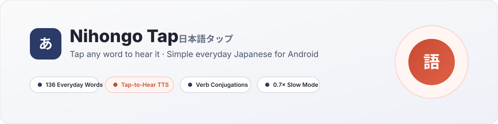
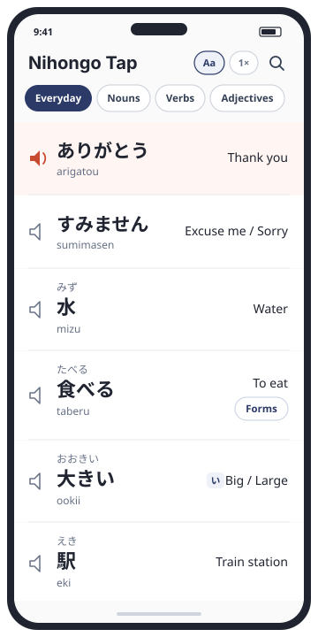
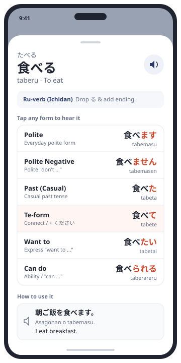
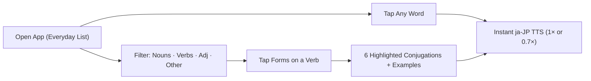

<p align="center">
  
</p>

<p align="center">
  <a href="https://github.com/radicelle/nihongo_tap/actions/workflows/release-apk.yml">
    
  </a>
  <a href="https://github.com/radicelle/nihongo_tap/actions/workflows/ci.yml">
    
  </a>
  <a href="https://github.com/radicelle/nihongo_tap/releases">
    
  </a>
  
</p>

A calm, distraction-free Android app for learning everyday Japanese vocabulary with instant tap-to-hear pronunciation and simple verb conjugations.

---

## App Preview

<table>
  <tr>
    <td align="center" width="50%">
      
      <br />
      <sub><strong>Everyday &amp; Categories</strong> — Tap any word to hear it</sub>
    </td>
    <td align="center" width="50%">
      
      <br />
      <sub><strong>Verb Forms &amp; Usage</strong> — Highlighted endings &amp; examples</sub>
    </td>
  </tr>
</table>

---

## How It Works



## Features

- **Tap-to-hear audio:** Touch any word, conjugated form, or example sentence to hear its Japanese (`ja-JP`) pronunciation via Android TTS.
- **Everyday first:** Opens on the **Everyday** tab ordered by daily usefulness (45 core daily words), alongside **Nouns**, **Verbs**, **Adjectives** (`い`/`な`), and **Other** (136 words total).
- **Simple verb conjugations:** Tap **Forms** on any verb to view its verb group rule, 6 essential forms (*Polite*, *Polite Negative*, *Past*, *Te-form*, *Want to*, *Can do*) with highlighted endings, and short example sentences.
- **Minimal controls:** Toggle Romaji (`Aa`), slow pronunciation (`0.7×` / `1×`), or instant search across English, kana, kanji, and romaji.

## Automatic Android Updates

Signed release APKs are built and published automatically to [GitHub Releases](https://github.com/radicelle/nihongo_tap/releases) on every push to `main` and every `v*.*.*` tag, with monotonically increasing `versionCode` for seamless in-place updates.

To get automatic updates on Android using **[Obtainium](https://obtainium.imranr.dev/)**:
1. Open Obtainium and tap **Add App**.
2. Paste `https://github.com/radicelle/nihongo_tap`.
3. Obtainium tracks new GitHub Releases and installs signed APK updates automatically.

## Testing & Local Development

```bash
# Install dependencies & verify static analysis
flutter pub get
flutter analyze

# Run unit, widget, and headless end-to-end tests
flutter test

# Run the on-device / emulator integration suite
flutter test integration_test/app_test.dart
```
